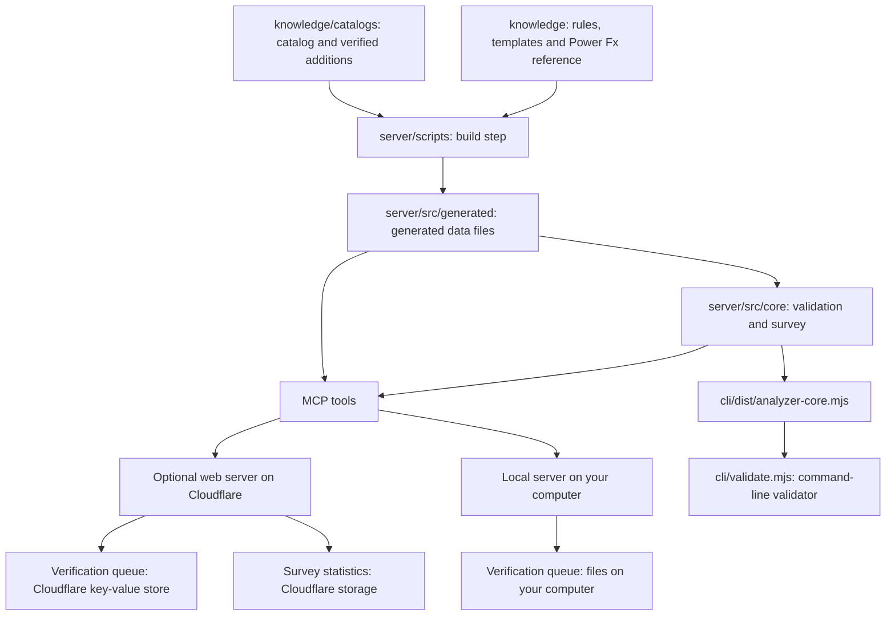

# AppForge architecture

*This page is for people working on AppForge itself. If you use AppForge through an AI assistant, you don't need it; see [Getting started](docs/getting-started.md).*

AppForge separates analysis semantics from transport, filesystem access, and
telemetry. The [glossary](docs/maintainers/CONTEXT.md) defines its domain terms; the
[roadmap](ROADMAP.md) describes planned capabilities.

## Core and adapters

`server/src/core/` contains the shared analyzer: catalog checks,
formula analysis, lint, source references, snapshots, fingerprints, survey
policy, report rendering, child-order comparison, modernization, and renaming.
Catalog data is injected into this core. Transport and filesystem behavior
belong in adapters rather than duplicate implementations of the rules.

The Worker and local stdio server call one JSON-RPC dispatcher in
`server/src/lib/rpc.ts`. It owns the tool registry, server instructions, initialization,
discovery, and tool dispatch. The CLI calls the same analyzer core through its
committed bundle; it does not use the JSON-RPC dispatcher.

## Execution surfaces

| Surface | Boundary |
|---|---|
| `server/src/index.ts` | Worker HTTP routing, bearer authentication, bounded request/response handling, and survey-envelope intake. |
| `server/src/local/server.ts` | Newline-delimited JSON-RPC over stdin/stdout, local file KV, and environment configuration. |
| `cli/validate.mjs` and `cli/lib/` | CLI arguments, file/archive intake, private report publication, baselines, and explicit envelope submission. |
| `server/src/lib/` and `server/src/tools/` | Generated-data injection, tool input checking, result adaptation, and telemetry. |
| `knowledge/personas/` | Repository prompts for understanding, diagnosis, documentation, and bounded renovation. |

Paths in this table are relative to the repository root. The MCP registry has
21 tools; see the [tool list](docs/developer-guide.md#the-21-tools).
`compile_canvas` and `sync_canvas` are Microsoft canvas-authoring operations,
outside AppForge's tool registry. Source transformations return proposed source
without writing to a tenant.

## Catalog and content build

`cli/extractor.mjs` captures control descriptions from
Microsoft's canvas-authoring MCP server. Its generated manifest and properties
are kept separate from the hand-maintained `control-augmentations.yml` overlay.
Studio-export entries are lower bounds; their omissions are not proof that a
property does not exist.

`server/scripts/build-catalog.mjs` reads those catalogs, rules, templates, and Power
Fx references into `server/src/generated/`. It checks catalog structure and rejects
dump-sourced controls that extraction already covers. The generated directory
is ignored by Git.

## Committed bundles

| Artifact | Builder | Consumer |
|---|---|---|
| `cli/dist/analyzer-core.mjs` | `server/scripts/build-core.mjs` | CLI adapter and vendored validation. |
| `server/dist-local/appforge-mcp.mjs` | `server/scripts/build-local.mjs` | MCP clients launching the local server with Node.js. |

`npm run build:core` builds the catalog first; `npm run build:local` builds the
core first. The development, test, and deployment hooks rebuild the core.
Regenerate the bundles rather than editing them. Their runtime imports require
no third-party npm modules; embedded reference material retains the terms in
[THIRD-PARTY-NOTICES.md](THIRD-PARTY-NOTICES.md).

## State and evidence boundaries

The Worker uses `VERIFICATION_QUEUE` KV for validation telemetry and the
`SURVEY_TELEMETRY` Durable Object for submitted survey envelopes and aggregates.
Local stdio uses file KV under the [configured data directory](docs/developer-guide.md#data-location)
and omits the survey submission binding. Inline HTTP tool calls send their
supplied source to the chosen server. Local CLI surveys need no submission;
`submit-envelope` is a separate explicit command.

Reports and minimized envelopes do not prove compiler acceptance or runtime
behavior. The [verification doctrine](knowledge/VERIFICATION-DOCTRINE.md)
governs evidence classes and catalog promotion. The
[release gate](CONTRIBUTING.md#development-setup) checks builds, tests, types, and
the corpus; it does not establish live deployment or tenant behavior.
